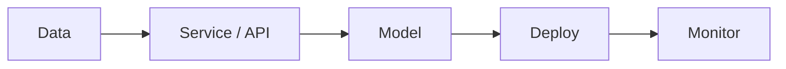

<h1 align="center">Saged Elqnawy</h1>

  <b>Most people own one layer. I'm learning to own the pipeline.</b> 
  Backend · Data pipelines · MLOps

  
  

---

## 👋 About

Computing & Data Science student at Alexandria University. Former big data analytics intern at WE (Telecom Egypt).

I'm not building isolated notebooks, APIs, or infra. I'm building the whole path: data in, service running, model deployed, system monitored, and learning how each piece breaks the next.

## 🔨 Currently building

- **[support-copilot](https://github.com/elqnawy/support-copilot)**: a tested, validated, logged FastAPI service (pytest, Pydantic, structured logging).
- **Next:** a RAG + evaluation project on top of it.

## 🧩 The pipeline, with receipts

| Layer | Status | Proof |
|---|---|---|
| Data | ✅ Done | Big data analytics internship, WE (Telecom Egypt) |
| Service / API | 🔨 Building | [support-copilot](https://github.com/elqnawy/support-copilot) |
| Model | ⏳ Next | |
| Deploy | ⏳ Next | |
| Monitor | ⏳ Next | |

## 💻 Stack

**Languages & data** 

**Services** 

**ML & MLOps** 

**Tooling** 

